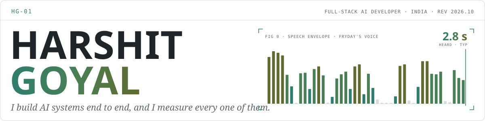

<a href="https://github.com/Analyst-Harsh">
<picture>
  <source media="(prefers-color-scheme: dark)" srcset="assets/banner-dark.svg">
  
</picture>
</a>

## 1 · General description who I am

**Full-stack AI developer: agents, RAG and on-device voice, from the model loop to the UI. I measure everything I ship.**

**Open to:** full-stack developer and forward-deployed engineer (FDE) roles · India or remote 
[LinkedIn](https://www.linkedin.com/in/harshit-goyal-ai/) · [harshit.1188@gmail.com](mailto:harshit.1188@gmail.com)

**Stack** Python · TypeScript · React · Next.js · FastAPI · LangGraph · Qdrant · MLX · PostgreSQL/pgvector 
**Currently building** Fryday v6, LLM hosting with vLLM and Triton

## 2 · Selected work typical performance

<a href="https://github.com/Analyst-Harsh/Fryday">
<picture>
  <source media="(prefers-color-scheme: dark)" srcset="assets/fig1-fryday-dark.svg">
  
</picture>
</a>

**Fig. 1 · [Fryday](https://github.com/Analyst-Harsh/Fryday)** — hands-free Hindi voice assistant, fully on a Mac, that you can interrupt mid-reply. 
Built: browser mic → Silero VAD → Whisper → Qwen3-4B → Kokoro TTS on Apple MLX, over a WebSocket; barge-in trims the reply in history to the words you actually heard. 
Measured: **~2.8 s voice→voice as heard** (n=3, 2.3–3.3 s). Server stage medians: VAD 0.50 · ASR 0.54 · reply→first audio 1.15 (first token 0.23); end-to-end median **2.14 s**.

<a href="https://github.com/Analyst-Harsh/Triage-Bot">
<picture>
  <source media="(prefers-color-scheme: dark)" srcset="assets/fig2-triage-dark.svg">
  
</picture>
</a>

**Fig. 2 · [Triage-Bot](https://github.com/Analyst-Harsh/Triage-Bot)** — LangGraph agent that triages GitHub issues · [live site ↗](https://analyst-harsh.github.io/Triage-Bot/) 
Built: Planner → Researcher → Drafter → Risk check → auto-post or approval queue, with Postgres checkpoints, pgvector episodic memory, a FastAPI operator API and a Next.js dashboard. 
Measured: cross-provider trajectory evals (an Anthropic judge grades an OpenAI-run agent); **6 OWASP LLM Top 10 prompt-injection cases** kept as regression tests.

<a href="https://github.com/Analyst-Harsh/DocMind">
<picture>
  <source media="(prefers-color-scheme: dark)" srcset="assets/fig3-docmind-dark.svg">
  
</picture>
</a>

**Fig. 3 · [DocMind](https://github.com/Analyst-Harsh/DocMind)** — eval-driven RAG with citations. 
Built: Next.js chat + FastAPI + Qdrant. Hybrid search, cross-encoder reranking, semantic caching, agentic and graph retrieval, each adopted or rejected by measurement. 
Measured: MRR **0.617 → 0.703 → 0.796** (dense → hybrid → reranked). Measurement caught a real bug: Graph RAG's entity expansion was dead code.

Figures animate in real time at the measured latency; reduced-motion shows the final state.

## 3 · More builds smaller tools

- [**signal-score**](https://github.com/Analyst-Harsh/signal-score): classical-ML issue-priority scorer with a gated MLflow promotion loop. It rejected all 4 challengers so far.
- [**treeflow**](https://github.com/Analyst-Harsh/treeflow): a pool of named git worktrees for running coding agents in parallel. Pure stdlib Python.
- [**claude-code-mods**](https://github.com/Analyst-Harsh/claude-code-mods): mods for Claude Code's own interface, such as side-ask.

## 4 · Electrical characteristics measured results

| Parameter | Typ | Test conditions |
|---|---:|---|
| [Voice→voice, as heard](https://github.com/Analyst-Harsh/Fryday/blob/main/docs/EXPERIMENTS.md) | ~2.8 s | Fryday, recorded real-mic session, n=3 (2.3–3.3 s) |
| [End-of-turn silence](https://github.com/Analyst-Harsh/Fryday/blob/main/docs/EXPERIMENTS.md) | 500 ms | Fryday, Silero VAD min silence |
| [Hybrid search recall gain](https://github.com/Analyst-Harsh/DocMind/blob/master/backend/EXPERIMENTS.md) | +7.5 pp | DocMind, Recall@5 0.850 → 0.925, 15-query golden set |
| [Reranking MRR](https://github.com/Analyst-Harsh/DocMind/blob/master/backend/EXPERIMENTS.md) | 0.703&nbsp;→&nbsp;0.796 | DocMind, cross-encoder, MRR@5 |
| [Semantic cache cost](https://github.com/Analyst-Harsh/DocMind/blob/master/backend/EXPERIMENTS.md) | −22.3% | DocMind, avg cost per query, 0.75 threshold |
| [LLM-judge disagreement](https://github.com/Analyst-Harsh/DocMind/blob/master/backend/EXPERIMENTS.md) | 30.4% | DocMind, 34 of 112 RAGAS scores re-judged |
| [Challengers promoted](https://github.com/Analyst-Harsh/signal-score/blob/main/EXPERIMENTS.md) | 0 of 4 | signal-score promotion gate (exp 2 was a sweep, not gated) |
| [Prompt-injection cases](https://github.com/Analyst-Harsh/Triage-Bot/blob/main/docs/agent/security.md) | 6 | Triage-Bot, OWASP LLM Top 10 (2025), regression-tested |

Typ = typical measured value; conditions as listed in the linked experiment log.

## 5 · Ordering information contact

**[LinkedIn](https://www.linkedin.com/in/harshit-goyal-ai/) · [harshit.1188@gmail.com](mailto:harshit.1188@gmail.com)**

HG-01 · Rev 2026.10 · All values measured; sources linked above.
